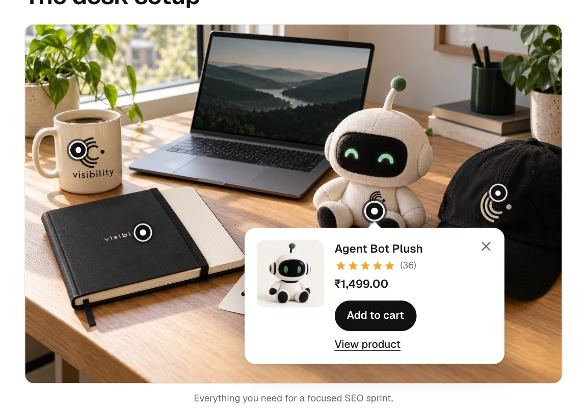
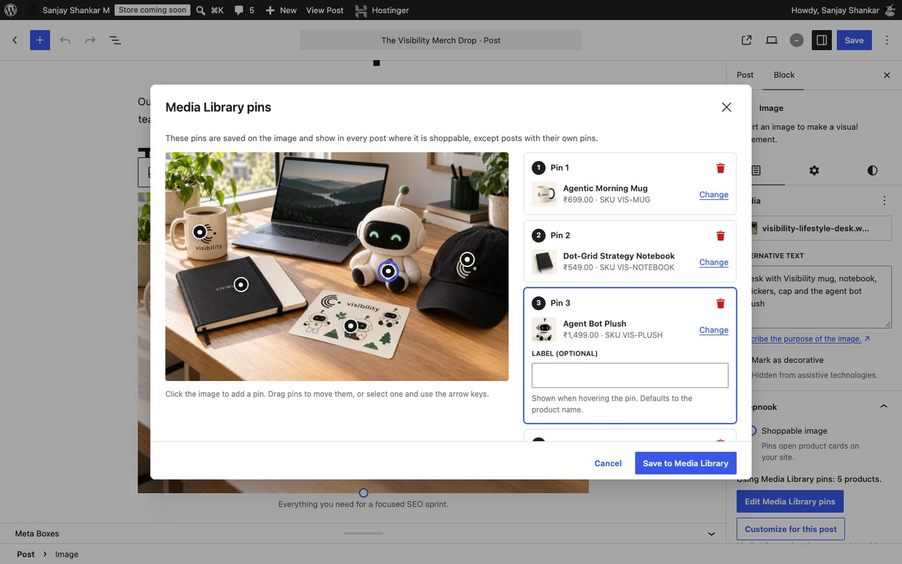
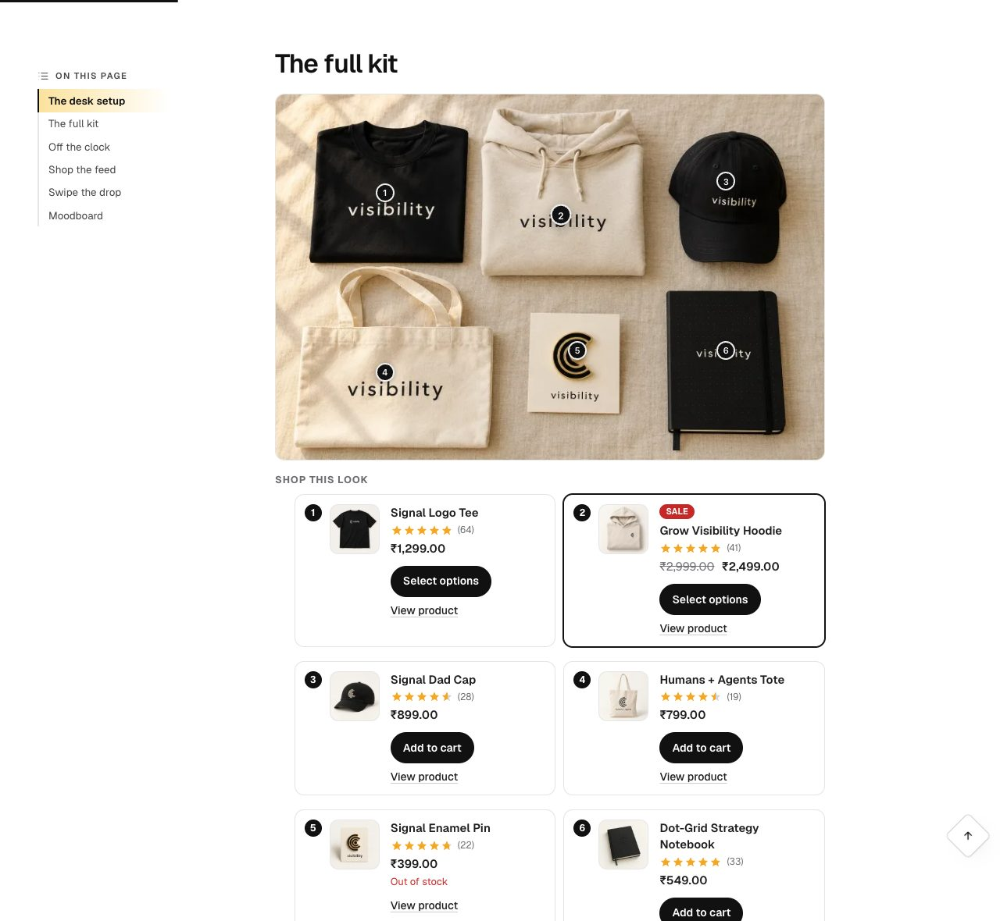
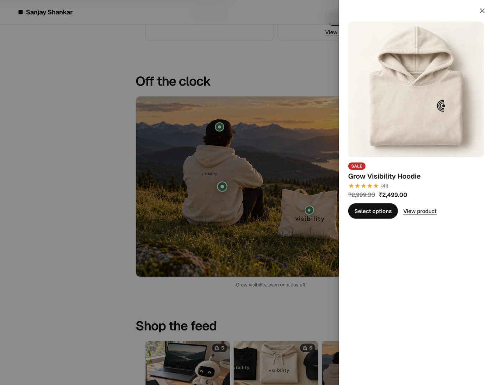
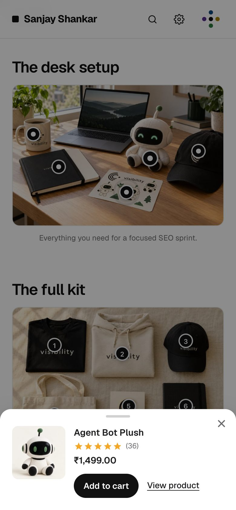
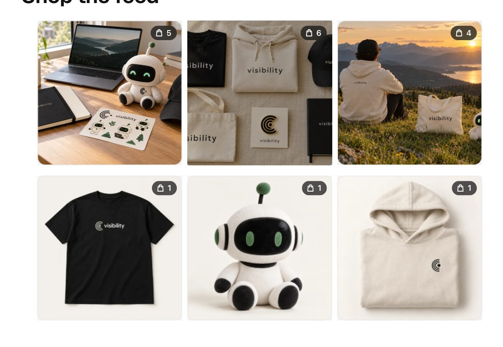
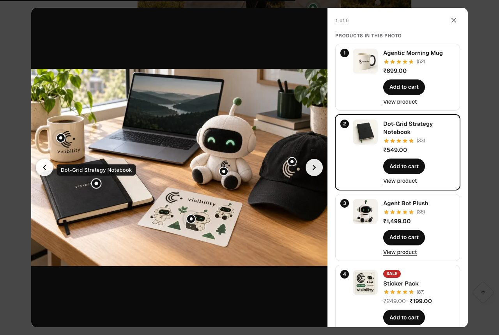
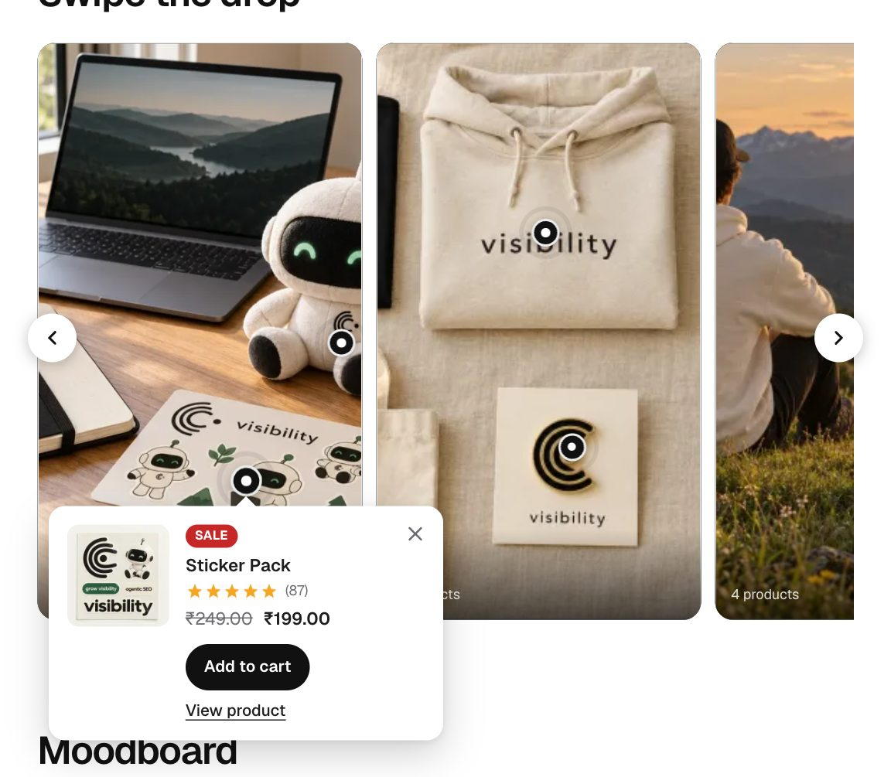
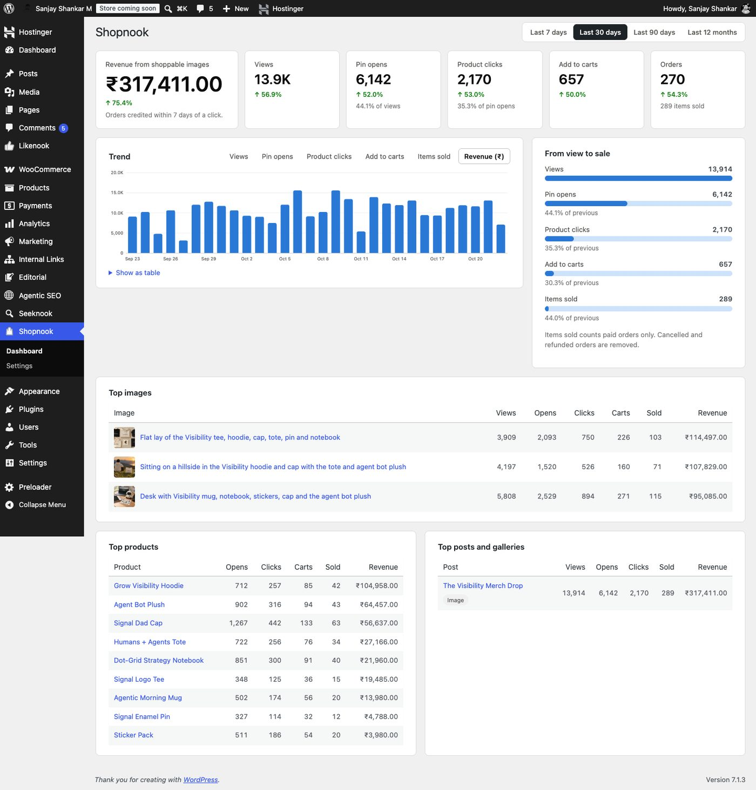
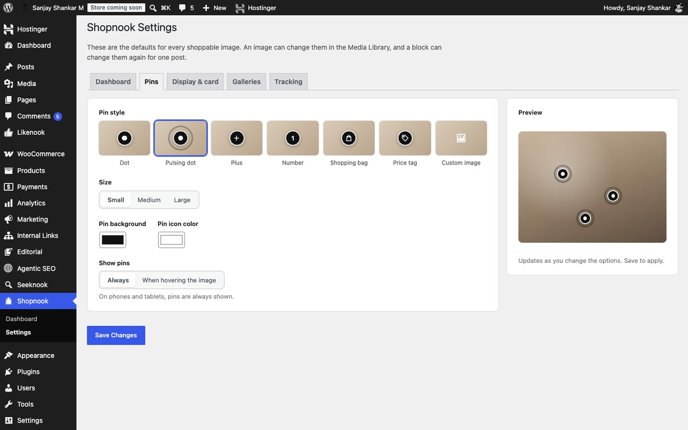

# Shopnook – Shoppable Images for WooCommerce, EDD & SureCart

[](https://wordpress.org/plugins/shopnook-shoppable-images/)

**Shopnook lets visitors buy the products they see in your photos.**

You put small dots (pins) on a photo in a WordPress post or page, one on each product in the picture. When a visitor taps a dot, a little card pops up with that product's name, price and an **Add to cart** button. They can buy it right there, without searching your shop.

Shopnook also shows you which photos actually sell: how many people saw each photo, tapped a product, and bought it.



---

## What is a "shoppable image"?

Think of an Instagram post where you can tap a jacket in the photo to see where to buy it. A shoppable image does the same thing on your own website, with products from your own store: **WooCommerce**, **Easy Digital Downloads** or **SureCart**.

| Without Shopnook | With Shopnook |
|---|---|
| A visitor likes the lamp in your photo, goes to your shop, searches for "lamp", scrolls, maybe gives up. | The visitor taps the lamp in the photo and adds it to the cart in one click. |
| You don't know if your blog photos lead to any sales. | You see views, taps, clicks, add to carts and revenue for every photo. |

## Works with your store

| Store plugin | Good for | On the product card | Sales credited |
|---|---|---|---|
| **WooCommerce** | Physical and digital products | Add to cart in place (simple products) | When the order is paid |
| **Easy Digital Downloads** | Ebooks, courses, templates, software | Add to cart in place (single-price downloads) | When the order is complete |
| **SureCart** | Products and subscriptions | **Buy now** to SureCart's instant checkout | When SureCart confirms the checkout |

You need one of them, and you can mix products from several in one photo. Refunds come back out of the stats. More store plugins are planned.

## Who is it for?

Anyone with a **WordPress** site that sells with **WooCommerce**, **Easy Digital Downloads** or **SureCart** and shows products in photos:

- **Clothing stores:** an outfit photo where every piece is tagged ("shop the look").
- **Furniture and home decor:** a styled living room where you can buy the sofa, the lamp and the rug.
- **Beauty brands:** a skincare routine photo with every bottle tagged.
- **Food and recipe sites:** the pans, knives and plates used in a recipe photo.
- **Gift guides:** one photo of all the gifts, each one tagged.
- **Company merch stores:** tees, hoodies, mugs and stickers styled together.
- **Bloggers who sell:** keep writing posts as usual; the photos in them now sell too.
- **Digital product sellers (EDD):** ebooks, courses, presets and templates, tagged in a photo of your workspace or a mockup.
- **SureCart stores:** creators and small brands selling products and subscriptions with SureCart's checkout.

## How it works (3 steps)

1. **Pick a photo.** In the WordPress editor, click any image in your post and switch on **Shoppable image**.
2. **Drop pins.** Click **Tag products**, click on the photo where a product is, and choose that product from your shop. Repeat for every product in the photo.
3. **Publish.** Visitors now see the pins. Tapping one shows the product.



**Tag once, use everywhere:** you can also tag a photo in the **Media Library**. Then every post that uses that photo gets the same pins automatically. A single post can still use its own pins if needed.

## What visitors see

You choose how the product appears when someone taps a pin:

| A small card next to the pin | A list of all products under the photo |
|---|---|
|  |  |
| **A panel that slides in from the side** | **A sheet from the bottom on phones** |
|  |  |

There is also a fourth option that opens the product in a box right below the photo.

The pins themselves can be dots, pulsing dots, numbers, plus signs, shopping bags, price tags or your own logo, in your brand colours.

## Shoppable galleries

Got several photos? Turn a whole gallery into a shoppable feed, in the style people already know from social media:

| Instagram-style grid | Tap a photo to shop it |
|---|---|
|  |  |

**Stories:** tall slides that visitors swipe through, with pins on every slide.



There is also a **Pinterest-style masonry** layout.

## See what your photos sell

The Shopnook dashboard answers "is this working?":

- **Revenue** made from your photos.
- How many people **saw** each photo, **tapped** a pin, **clicked** a product and **added it to the cart**.
- **Orders** and items sold.
- Your **best photos, products and posts**.
- Everything compared with the previous period, so you can see the trend.



A sale counts for a photo when someone taps a product in it and buys that product within 7 days (you can change the number of days). Only paid orders count. Cancelled or refunded orders are removed.

## Privacy

- No personal data and no IP addresses are stored, only anonymous daily totals ("42 views today").
- One small cookie remembers which photo a shopper came from, so the sale can be credited. It expires after the credit window.
- If your site uses a cookie consent banner that supports the WP Consent API, nothing is tracked until the visitor agrees.
- No outside services for your shop or your visitors: stats stay in your own WordPress database. The only outside service is an optional newsletter sign-up for site admins (see below).

## Newsletter card for admins

Admins see a "Plugins by Sanjay Shankar" card on the Shopnook dashboard with an optional newsletter sign-up for new plugins, betas and offers. Nothing is sent unless an admin types an email and clicks **Subscribe**. Then the email, first name (optional) and the plugin name go to [Brevo](https://www.brevo.com/). Closing it hides it for 30 days, it stops once the site has subscribed, and visitors never see it. The same form stays available at the bottom of **Shopnook → Settings**. All plugins by Sanjay Shankar share this one card, so a site with several of them sees it once.

## Good to know

- **Works with the normal WordPress Image and Gallery blocks.** If you turn Shopnook off, your photos simply show as normal photos. Nothing breaks.
- **Fast:** its small script only loads on pages that have a shoppable photo.
- **Keyboard and screen reader friendly.**
- **Works with block themes and classic themes.**
- **Free.**

## Requirements

- WordPress 6.5 or newer
- One store plugin: WooCommerce 8.0 or newer, Easy Digital Downloads 3.0 or newer, or SureCart
- PHP 7.4 or newer

## Install

1. Make sure your store plugin (WooCommerce, Easy Digital Downloads or SureCart) is installed and active.
2. In WordPress, go to **Plugins → Add New**, search for **Shopnook**, install and activate. It is also on [WordPress.org](https://wordpress.org/plugins/shopnook-shoppable-images/).
3. Edit a post, click an image, switch on **Shoppable image** and click **Tag products**.
4. Optional: choose your pin style, colours and card layout under **Shopnook → Settings**.



## Questions

**Where is the Shopnook switch in the editor?**
Click the image, then look in the right-hand sidebar. In WordPress 7.0 and later it is under the **Content** tab.

**I tagged a photo in the Media Library but no pins show.**
Open the post, click the image and switch on **Shoppable image**. Media Library pins show wherever that switch is on.

**Can I tag Amazon or other stores' products?**
Not in this version. Shopnook tags products from your own WooCommerce, Easy Digital Downloads or SureCart store.

**Does it work with page builders like Elementor?**
Version 1.0 works in the WordPress block editor. More editors are planned.

More answers are in [`readme.txt`](readme.txt), which is also the WordPress.org listing.

---

## For developers

<details>
<summary>Code layout, commands, hooks and data</summary>

### Layout

- `shopnook.php` – bootstrap.
- `includes/stores/` – one class per store plugin (WooCommerce, Easy Digital Downloads, SureCart): cards, product search, add to cart and sales credit. Add your own through the `shopnook_stores` filter.
- `includes/` – settings, pins, Media Library pins, rendering (images and galleries), products, tracking and attribution, stats, REST, editor loader, privacy.
- `includes/admin/` – dashboard and settings screens.
- `assets/js/` – `shopnook.js` (front end, no dependencies), `pin-editor.js` (shared pin editor), `block-editor.js`, `media.js`, `admin.js`. Plain scripts on the `wp.*` globals, no build step.
- `bin/` – development only (excluded from the release zip).
- `.wordpress-org/` – WordPress.org listing assets: animated icon (source in `bin/brand/`), banners, screenshots and the Live Preview blueprint.

### Commands

```sh
./bin/lint                                   # PHP/JSON/JS syntax checks
wp eval-file bin/test-integration.php        # integration checks (needs WooCommerce)
wp eval-file bin/test-stores.php             # EDD and SureCart checks (skips stores that are not active)
./bin/build-blueprint --local /tmp/bp.json   # Playground blueprint with a demo shop
./bin/build-zip                              # distribution zip
```

Playground with the demo shop:

```sh
npx @wp-playground/cli@3 server --php=8.3 --wp=latest \
  --mount="$PWD:/wordpress/wp-content/plugins/shopnook" \
  --blueprint=/tmp/bp.json --login
```

### Hooks

- `shopnook_product_card` (filter): the data a product card shows, `( array $card, object $product )`. `$card['store']` is `woocommerce`, `edd` or `surecart`.
- `shopnook_stores` (filter): the list of `Shopnook_Store` integrations.
- `shopnook_stats_capability` (filter): who can see the dashboard.

### Shared newsletter card (`includes/connect/`)

The "Plugins by Sanjay Shankar" card is one module shared by all of the author's plugins. To add it to another plugin, copy `includes/connect/` and change the text domain `shopnook` in `class-sanjayshankar-connect.php` to that plugin's slug. Then:

```php
require_once __DIR__ . '/includes/connect/connect.php';
add_filter( 'sanjayshankar_connect_plugins', function ( $plugins ) {
	$plugins['likenook'] = 'Likenook';
	return $plugins;
} );
// Dismissible card on the plugin's dashboard screen:
do_action( 'sanjayshankar_connect_card', 'likenook' );
// Permanent box at the bottom of the plugin's settings screen (outside its <form>):
do_action( 'sanjayshankar_connect_box', 'likenook' );
```

Register with an array to also get the deactivation survey: `$plugins['likenook'] = array( 'name' => 'Likenook', 'file' => plugin_basename( __FILE__ ), 'version' => LIKENOOK_VERSION );`. Answers go to `SanjayShankar_Connect::FEEDBACK_URL`, a Google Apps Script web app (`bin/feedback-receiver.gs`) that writes one row per answer to the tab named after the plugin's slug.

When several plugins carry the module, the newest version runs and the card shows once per site. State: option `sanjayshankar_connect` (`subscribed`) and user meta `sanjayshankar_connect_hidden_until`; both are shared, so uninstalling one plugin leaves them for the others. Sign-ups go to the Brevo form in `SanjayShankar_Connect::FORM_URL` with `EMAIL`, `FIRSTNAME` and `PLUGIN`.

### Data

- Option `shopnook_settings`.
- Attachment meta `_shopnook_image` (`hotspots`, `overrides`).
- Block attribute `shopnook` on `core/image` and `core/gallery` (`enabled`, `custom`, `hotspots`, `overrides`, gallery `layout`, `columns`).
- Table `{prefix}shopnook_stats`: daily counters per event, post, image and product.
- Order meta `_shopnook_attribution`, `_shopnook_counted`.
- Cookie `shopnook_ref`: `product.source.attachment.post.timestamp` entries joined by `_`.
- REST: `shopnook/v1/products`, `shopnook/v1/images/{id}`, `shopnook/v1/events`.

### Releases

Push a `v*` tag that matches `Stable tag` in `readme.txt` and `Version` in `shopnook.php`; `.github/workflows/deploy.yml` builds and publishes to WordPress.org. `.github/workflows/assets.yml` syncs `.wordpress-org/` to WordPress.org when it changes on `main`, once the repository variable `WPORG_LIVE` is `true`. Both need the `SVN_USERNAME` and `SVN_PASSWORD` repository secrets.

</details>

## Need a custom feature?

Want Shopnook to do something it does not do yet, an integration with another plugin, or help setting it up on your store? [Get in touch](https://sanjayshankar.me/contact/). Feature requests are also welcome in the [support forum](https://wordpress.org/support/plugin/shopnook-shoppable-images/) or as a [GitHub issue](https://github.com/sanjuacodez/shopnook/issues).

## Support Shopnook

Shopnook is free, with no locked features. If it helps your shop:

[](https://buymeacoffee.com/sanjayshankar)

- ⭐ [Leave a review on WordPress.org](https://wordpress.org/support/plugin/shopnook-shoppable-images/reviews/#new-post)
- 🐞 [Report a bug or suggest a feature](https://github.com/sanjuacodez/shopnook/issues)

## More plugins by Sanjay Shankar

- [Likenook – Like Dislike Buttons](https://wordpress.org/plugins/likenook/): like and dislike buttons with "Was this helpful?" feedback and analytics.
- [Anchormap – AI Internal Linking & Link Map](https://wordpress.org/plugins/anchormap/): a visual link map, orphan page finder and internal link suggestions.
- [Seasonal Effects & Notice Bar](https://wordpress.org/plugins/halloween-animations/): festive animations, countdown timers and notice bars.
- [Advanced Preloader](https://wordpress.org/plugins/advanced-preloader/): loading animations while your site loads.

**Find me:** [sanjayshankar.me](https://sanjayshankar.me) · [LinkedIn](https://www.linkedin.com/in/sanjay-shankar-a6885224/) · [X](https://x.com/sanjayshankarr) · [GitHub](https://github.com/sanjuacodez) · [WordPress.org](https://profiles.wordpress.org/sanju-shankar/)

## License

GPLv2 or later. Made by [Sanjay Shankar](https://sanjayshankar.me).
