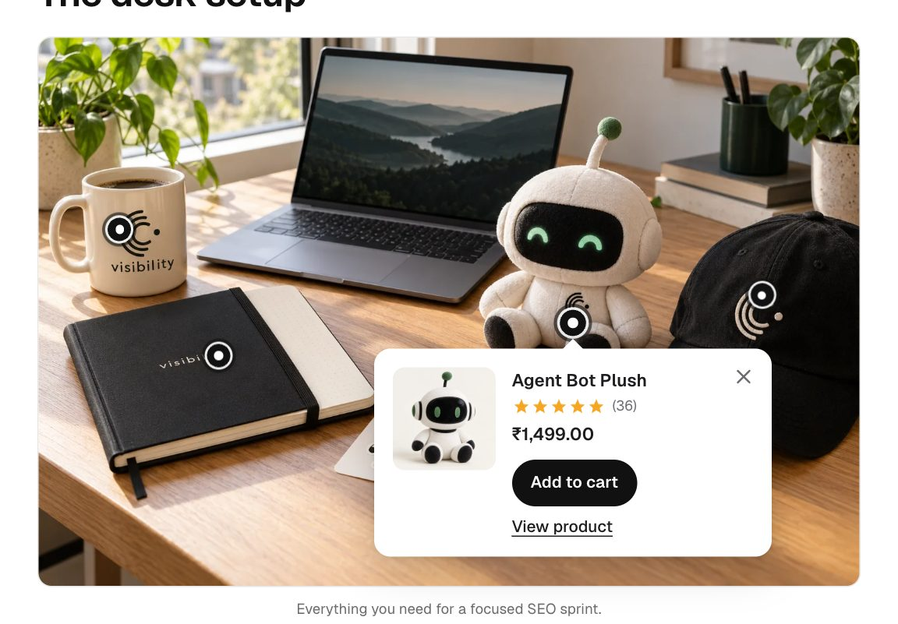
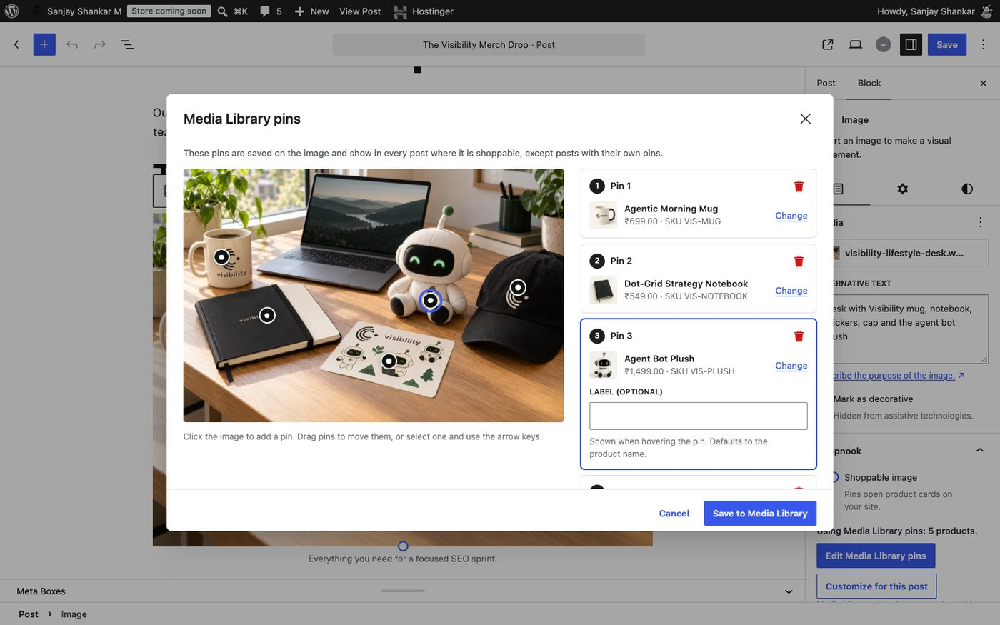
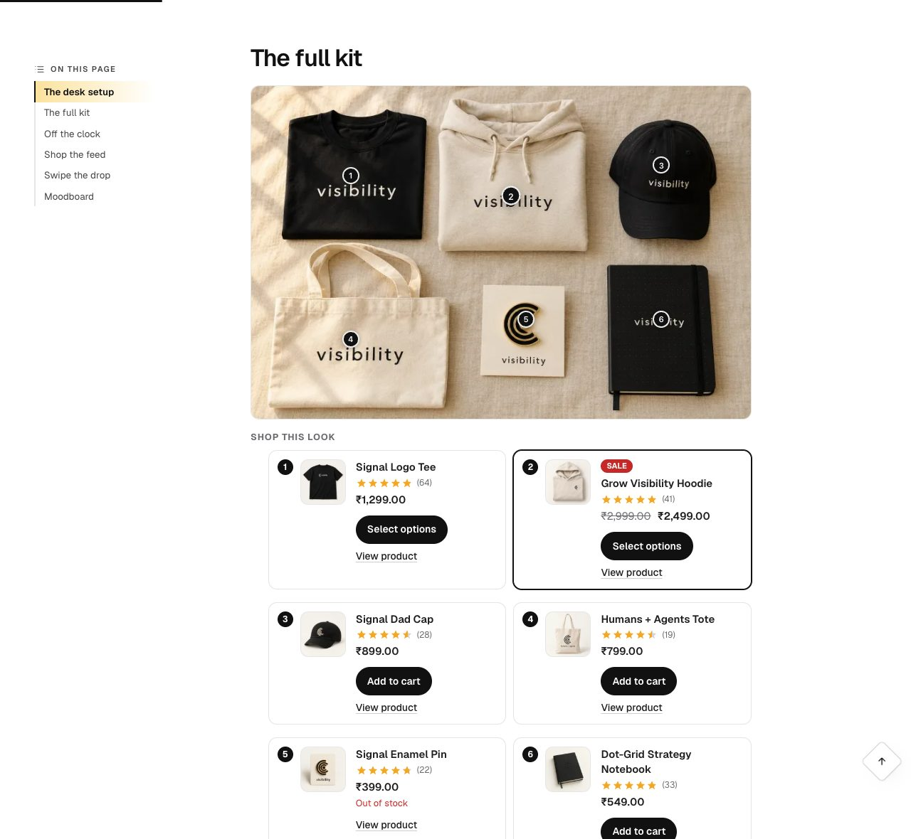
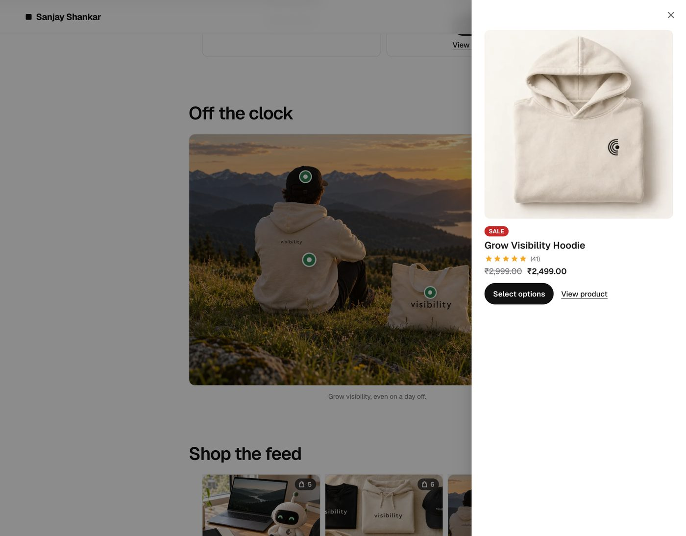
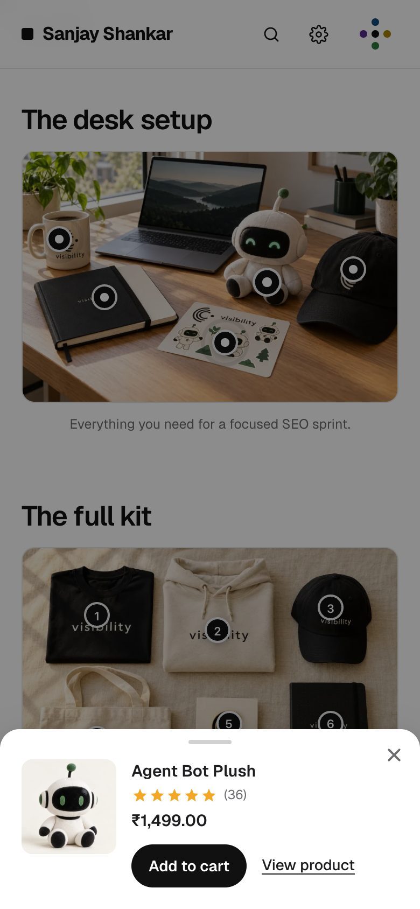
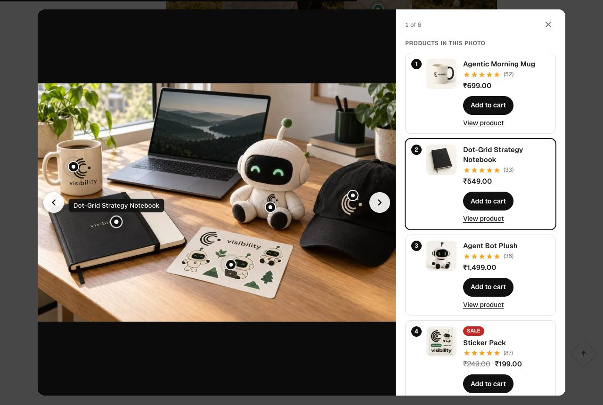
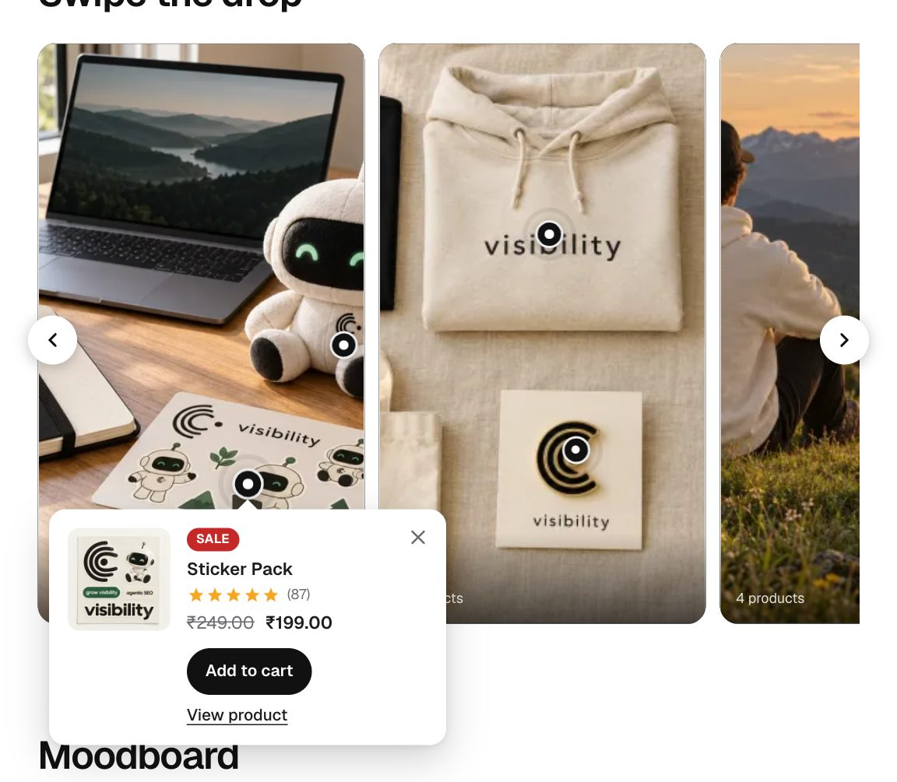
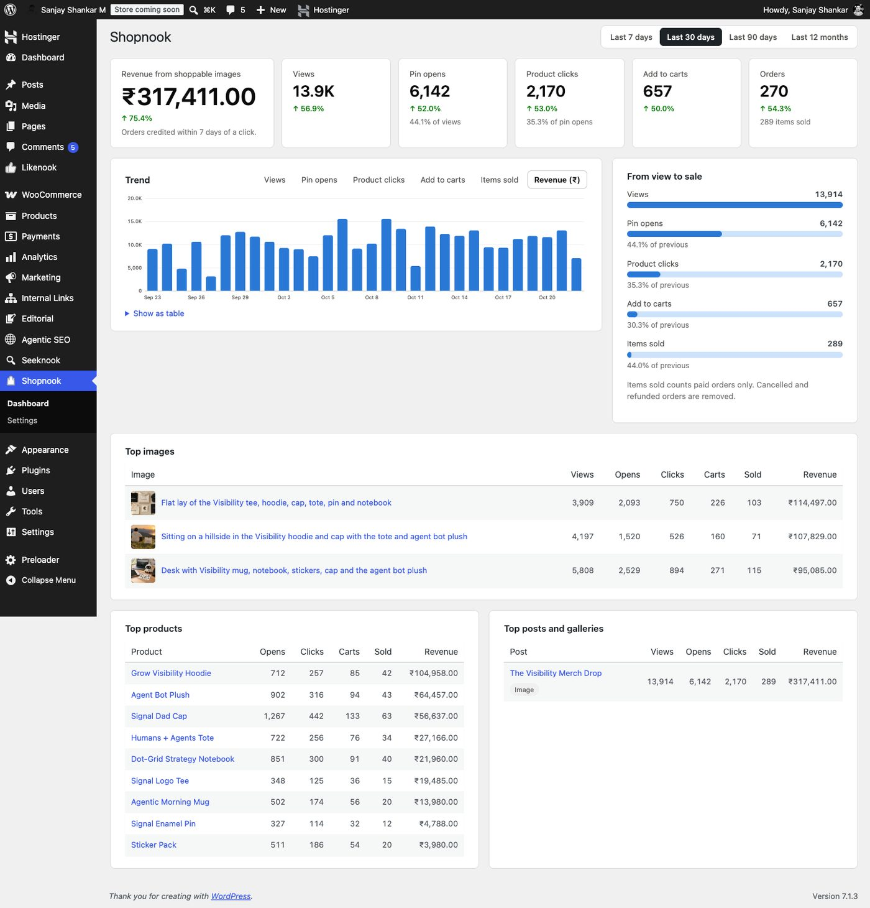
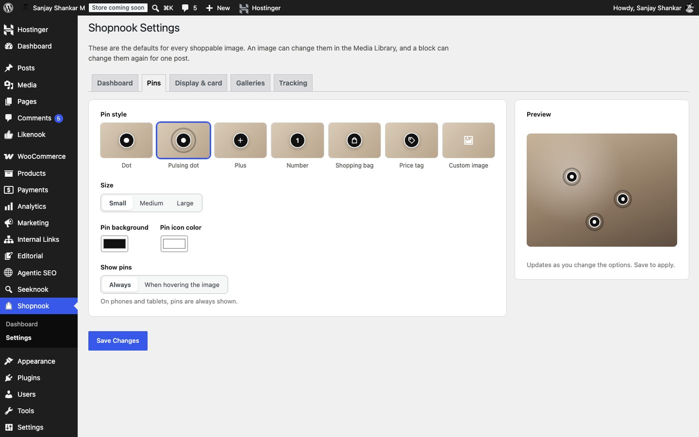

# Shopnook – Shoppable Images for WooCommerce

**Shopnook lets visitors buy the products they see in your photos.**

You put small dots (pins) on a photo in a WordPress post or page, one on each product in the picture. When a visitor taps a dot, a little card pops up with that product's name, price and an **Add to cart** button. They can buy it right there, without searching your shop.

Shopnook also shows you which photos actually sell: how many people saw each photo, tapped a product, and bought it.



---

## What is a "shoppable image"?

Think of an Instagram post where you can tap a jacket in the photo to see where to buy it. A shoppable image does the same thing on your own website, with products from your own WooCommerce store.

| Without Shopnook | With Shopnook |
|---|---|
| A visitor likes the lamp in your photo, goes to your shop, searches for "lamp", scrolls, maybe gives up. | The visitor taps the lamp in the photo and adds it to the cart in one click. |
| You don't know if your blog photos lead to any sales. | You see views, taps, clicks, add to carts and revenue for every photo. |

## Who is it for?

Anyone with a **WordPress** site that sells with **WooCommerce** and shows products in photos:

- **Clothing stores:** an outfit photo where every piece is tagged ("shop the look").
- **Furniture and home decor:** a styled living room where you can buy the sofa, the lamp and the rug.
- **Beauty brands:** a skincare routine photo with every bottle tagged.
- **Food and recipe sites:** the pans, knives and plates used in a recipe photo.
- **Gift guides:** one photo of all the gifts, each one tagged.
- **Company merch stores:** tees, hoodies, mugs and stickers styled together.
- **Bloggers who sell:** keep writing posts as usual; the photos in them now sell too.

## How it works (3 steps)

1. **Pick a photo.** In the WordPress editor, click any image in your post and switch on **Shoppable image**.
2. **Drop pins.** Click **Tag products**, click on the photo where a product is, and choose that product from your shop. Repeat for every product in the photo.
3. **Publish.** Visitors now see the pins. Tapping one shows the product.



**Tag once, use everywhere:** you can also tag a photo in the **Media Library**. Then every post that uses that photo gets the same pins automatically. A single post can still use its own pins if needed.

## What visitors see

You choose how the product appears when someone taps a pin:

| A small card next to the pin | A list of all products under the photo |
|---|---|
|  |  |
| **A panel that slides in from the side** | **A sheet from the bottom on phones** |
|  |  |

There is also a fourth option that opens the product in a box right below the photo.

The pins themselves can be dots, pulsing dots, numbers, plus signs, shopping bags, price tags or your own logo, in your brand colours.

## Shoppable galleries

Got several photos? Turn a whole gallery into a shoppable feed, in the style people already know from social media:

| Instagram-style grid | Tap a photo to shop it |
|---|---|
|  |  |

**Stories:** tall slides that visitors swipe through, with pins on every slide.



There is also a **Pinterest-style masonry** layout.

## See what your photos sell

The Shopnook dashboard answers "is this working?":

- **Revenue** made from your photos.
- How many people **saw** each photo, **tapped** a pin, **clicked** a product and **added it to the cart**.
- **Orders** and items sold.
- Your **best photos, products and posts**.
- Everything compared with the previous period, so you can see the trend.



A sale counts for a photo when someone taps a product in it and buys that product within 7 days (you can change the number of days). Only paid orders count. Cancelled or refunded orders are removed.

## Privacy

- No personal data and no IP addresses are stored, only anonymous daily totals ("42 views today").
- One small cookie remembers which photo a shopper came from, so the sale can be credited. It expires after the credit window.
- If your site uses a cookie consent banner that supports the WP Consent API, nothing is tracked until the visitor agrees.
- No outside services. Everything stays in your own WordPress database.

## Good to know

- **Works with the normal WordPress Image and Gallery blocks.** If you turn Shopnook off, your photos simply show as normal photos. Nothing breaks.
- **Fast:** its small script only loads on pages that have a shoppable photo.
- **Keyboard and screen reader friendly.**
- **Works with block themes and classic themes.**
- **Free.**

## Requirements

- WordPress 6.5 or newer
- WooCommerce 8.0 or newer
- PHP 7.4 or newer

## Install

1. Make sure WooCommerce is installed and active.
2. In WordPress, go to **Plugins → Add New**, search for **Shopnook**, install and activate. (Before it is listed on WordPress.org, download this repository as a zip or build one with `./bin/build-zip`, then use **Upload Plugin**.)
3. Edit a post, click an image, switch on **Shoppable image** and click **Tag products**.
4. Optional: choose your pin style, colours and card layout under **Shopnook → Settings**.



## Questions

**Where is the Shopnook switch in the editor?**
Click the image, then look in the right-hand sidebar. In WordPress 7.0 and later it is under the **Content** tab.

**I tagged a photo in the Media Library but no pins show.**
Open the post, click the image and switch on **Shoppable image**. Media Library pins show wherever that switch is on.

**Can I tag Amazon or other stores' products?**
Not in this version. Shopnook tags products from your own WooCommerce store.

**Does it work with page builders like Elementor?**
Version 1.0 works in the WordPress block editor. More editors are planned.

More answers are in [`readme.txt`](readme.txt), which is also the WordPress.org listing.

---

## For developers

<details>
<summary>Code layout, commands, hooks and data</summary>

### Layout

- `shopnook.php` – bootstrap.
- `includes/` – settings, pins, Media Library pins, rendering (images and galleries), products, tracking and attribution, stats, REST, editor loader, privacy.
- `includes/admin/` – dashboard and settings screens.
- `assets/js/` – `shopnook.js` (front end, no dependencies), `pin-editor.js` (shared pin editor), `block-editor.js`, `media.js`, `admin.js`. Plain scripts on the `wp.*` globals, no build step.
- `bin/` – development only (excluded from the release zip).
- `.wordpress-org/` – WordPress.org listing assets (screenshots; icon, banners and Live Preview blueprint to come).

### Commands

```sh
./bin/lint                                   # PHP/JSON/JS syntax checks
wp eval-file bin/test-integration.php        # integration checks (needs WooCommerce)
./bin/build-blueprint --local /tmp/bp.json   # Playground blueprint with a demo shop
./bin/build-zip                              # distribution zip
```

Playground with the demo shop:

```sh
npx @wp-playground/cli@3 server --php=8.3 --wp=latest \
  --mount="$PWD:/wordpress/wp-content/plugins/shopnook" \
  --blueprint=/tmp/bp.json --login
```

### Hooks

- `shopnook_product_card` (filter): the data a product card shows, `( array $card, WC_Product $product )`.

### Data

- Option `shopnook_settings`.
- Attachment meta `_shopnook_image` (`hotspots`, `overrides`).
- Block attribute `shopnook` on `core/image` and `core/gallery` (`enabled`, `custom`, `hotspots`, `overrides`, gallery `layout`, `columns`).
- Table `{prefix}shopnook_stats`: daily counters per event, post, image and product.
- Order meta `_shopnook_attribution`, `_shopnook_counted`.
- Cookie `shopnook_ref`: `product.source.attachment.post.timestamp` entries joined by `_`.
- REST: `shopnook/v1/products`, `shopnook/v1/images/{id}`, `shopnook/v1/events`.

### Releases

Push a `v*` tag that matches `Stable tag` in `readme.txt` and `Version` in `shopnook.php`; `.github/workflows/deploy.yml` builds and publishes to WordPress.org. `.github/workflows/assets.yml` syncs `.wordpress-org/` to WordPress.org when it changes on `main`, once the repository variable `WPORG_LIVE` is `true`. Both need the `SVN_USERNAME` and `SVN_PASSWORD` repository secrets.

</details>

## License

GPLv2 or later. Made by [Sanjay Shankar](https://sanjayshankar.me).
